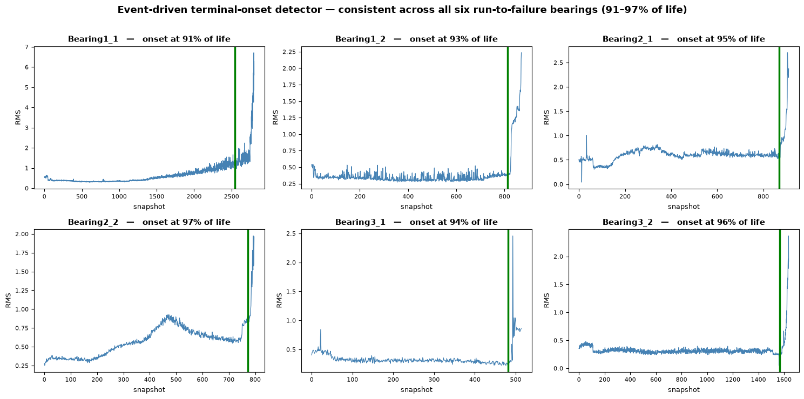
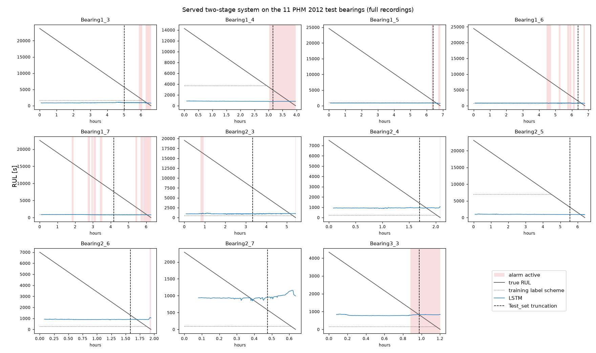
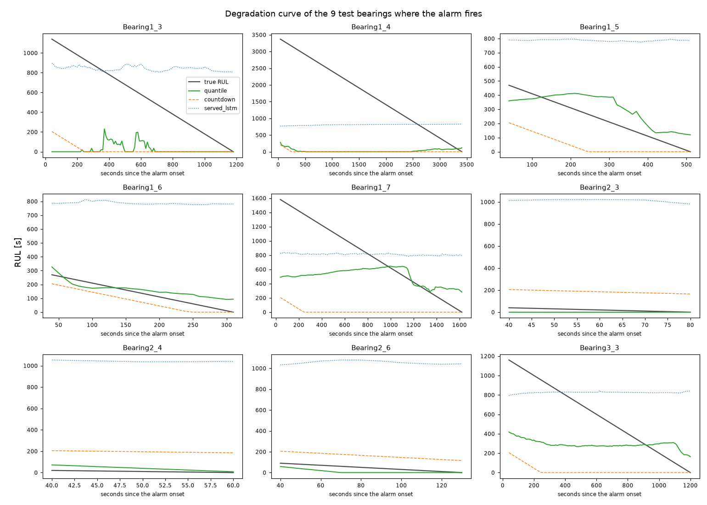

# RUL Estimation on FEMTO-ST Bearings — XGBoost vs. LSTM/GRU, and a Containerised Two-Stage Inference Service

[](https://github.com/yuri-amorelli/femto-rul/actions/workflows/ci.yml)

> A Remaining Useful Life (RUL) study on run-to-failure bearings that reaches a
> counter-intuitive conclusion: on this data the **model choice barely matters** —
> the **labelling scheme** is the dominant lever, and the real bottleneck is the
> *observability of the terminal collapse*, not model capacity. On the 11
> official test bearings, at the challenge's truncation point, the `capped`
> models score below a constant prediction and the LSTM the API first served
> barely moves (787–996 s against true RULs of 339–7570 s). The reusable
> contributions are an **event-driven degradation detector** (consistent onset at
> 91–97 % of life), inspired by my first-author IEEE algorithm **IFCR**, and its
> **causal, self-calibrating counterpart** that powers a containerized FastAPI
> inference service — where taking the detector online exposed (and fixed) an
> artifact the offline version had silently produced.



*The slope-based detector places the terminal-degradation onset (green line)
consistently near the start of the final collapse on every training bearing —
91–97 % of life, versus 32–99 % for a naïve RMS-threshold detector.*

Remaining Useful Life (RUL) estimation on the FEMTO-ST / PRONOSTIA run-to-failure
bearing dataset (IEEE PHM 2012 Prognostic Challenge). The project compares a
**gradient-boosting baseline (XGBoost)** on engineered condition-monitoring
features against a **recurrent sequence model (LSTM / GRU, PyTorch)** on the same
features, and reports results with regression metrics and the official asymmetric
PHM 2012 score. The two-stage system (detector → RUL regression) is then
productionized as a **stateless FastAPI service, packaged with Docker and deployed
on AWS EC2**: a [live demo page](http://13.63.29.23:8000/) replays any of the 11
official test bearings through the deployed service
([API docs](http://13.63.29.23:8000/docs)).

The goal of the repository is methodological honesty, not a leaderboard number:
the comparison is designed so that the *only* thing that changes between baseline
and sequence model is whether temporal context is modelled explicitly.

## Headline result (read this first)

> **Correction (October 2026).** Earlier versions of this README reported
> test-set numbers computed on the *truncated* test runs, labelled as if each run
> ended in failure, on 3 of the 11 test bearings. Those labels were wrong by the
> bearing's whole remaining life (5730 s on Bearing1_3), so the old table (RMSE
> 471–742 s) and the PHM score are withdrawn. Everything below uses the 11
> official test bearings, with ground truth from their full recordings;
> *Evaluation on the 11 official test bearings* explains what went wrong and how
> the new ground truth was checked.

Challenge protocol: one prediction per bearing at the truncation point, scored
with the official asymmetric function (mean A_i over the 11 bearings, 1.0 is
perfect, late predictions cost more than early ones).

| Model | Labels | Challenge score | Mean \|Er\| | Full-run RMSE |
|---|---|:---:|:---:|:---:|
| XGBoost | `capped` | 0.068 (0.068) | 89.5 % | 738 s |
| LSTM, mean ± std over 5 seeds | `capped` | 0.096 ± 0.039 (0.091) | 89.2 % | 796 ± 95 s |
| Whole-life LSTM of the two-stage system (served until v0.1) | `piecewise_slope` | 0.203 (0.210) | 61.4 % | n/a |
| Constant 900 s, no model | none | 0.147 (0.156) | 64.5 % | n/a |
| Constant 2500 s (the `capped` plateau) | none | 0.078 (0.135) | 153.0 % | n/a |

*In brackets: the score with Bearing1_4's recorded RUL (2890 s) instead of the
official 339 s. Full-run RMSE is measured against each model's own label scheme,
so it only compares rows with the same labels.*

1. **No model does clearly better than a constant.** The `capped` models score
   below a constant 900 s. The two-stage LSTM scores above it, but its own
   predictions stay within 787–996 s on all 11 bearings, so in practice it *is*
   a constant. At the truncation point most test bearings are still healthy, and
   a plateau label (`capped`, `piecewise_*`) cannot express a RUL longer than its
   plateau by construction. The `capped` models predict between 1840 and 2600 s
   on seven of the eleven bearings whatever their true RUL: late on the bearings
   with little life left, where A_i falls to about zero, and far too early on
   Bearing2_3, which has two hours left.
2. **LSTM vs XGBoost is within seed variance**, as it was before the correction:
   0.096 ± 0.039 against 0.068, RMSE 796 ± 95 s against 738 s. The best seed
   (0.161) owes half of its score to two bearings (Bearing1_4 and Bearing3_3
   contribute 0.084). Explicit temporal modelling does **not** buy a robust
   improvement here.
3. **The labelling scheme moves the score more than the model, for an
   unflattering reason.** The two-stage `piecewise_slope` LSTM scores 0.203 because
   its fallback value (~900 s, close to the average plateau of its labels) sits closer to
   the actual RULs than the `capped` plateau of 2500 s, not because it tracks
   degradation.

Recognising *when* a bearing is degrading is therefore the detector's job, and it
is what the **two-stage, event-driven system** below is built around: the
detector raises the alarm and only then is a RUL exposed. On the 11 unseen
bearings the causal detector has its alarm active at end of life on 9, with a
median warning of 510 s. The RUL the whole-life LSTM then exposed did not track the
collapse. Retrained on the degradation curve only, stage 2 halves that error and
beats a countdown on all 9 bearings where the alarm fires, and it is what the API
serves since v0.2. Its typical error is still about three quarters of the
remaining life: the terminal phase is too fast and sample-poor in these
accelerated tests, a *data* limit documented below. On a second test rig it had never
seen (XJTU-SY), a pre-registered transfer test with nothing retuned finds the end of
life on 10 of 11 bearings but fails its rule on early alarms, and stage 2 does not
transfer (*A second test rig: XJTU-SY*, below).

## Why this is set up the way it is

- **Shared features for both models.** Time- and frequency-domain health
  indicators (RMS, kurtosis, crest factor, spectral band energies, …) are
  extracted once per snapshot and fed to *both* XGBoost and the RNN. This
  isolates the effect of temporal modelling from the effect of a richer input.
- **RUL labelling is the hard part, and it drives the results.** A naïve linear
  RUL (`total_life − t`) asserts the bearing is dying from t=0, which is
  physically false. Several schemes are implemented and compared: `linear`,
  `capped` (`min(linear_rul, C)` with a fixed constant `C`), and
  `piecewise_slope` (plateau until a *detected* terminal-onset, then a ramp).
  An early RMS-threshold onset detector proved fragile — First Prediction Time
  ranged from 32% to 99% of life — so on the **full trajectory** the reported
  numbers use `capped` (`C = 2500 s`), consistent across bearings. The robust
  slope-based detector and the event-driven `piecewise_slope`
  scheme are where this project's main contribution lives (see the two-stage
  section below).
- **No data leakage.** Train/test split is **by bearing**, never by random
  snapshot. Feature scalers are fit on training bearings only, per operating
  condition. Early stopping uses a held-out *training* bearing, not the test set.
- **Asymmetric evaluation.** Alongside RMSE/MAE, the PHM 2012 score penalises
  late (over-optimistic) predictions harder than early ones.
- **Test ground truth from the full recordings.** The official test runs stop
  before failure; their labels come from `Full_Test_Set`, the same bearings
  recorded to the end, and every result covers all 11 test bearings.

## Relation to prior work (IFCR)

The weak point above — turning fault events into a sound supervised RUL target —
is exactly the problem addressed by **Inverted Fault Count Regression (IFCR)**,
the labelling algorithm introduced in my first-author paper (see references).
IFCR builds the RUL target from **explicit, repeating fault counters**: it counts
recordings since the last fault, resets on each fault, and inverts the interval
to get a remaining-life column — well suited to assets that fail repeatedly (e.g.
a water pump with several failures over its monitoring period).

FEMTO-ST is a *different* regime: each bearing is **run-to-failure** (a single
terminal event, no repeating counter), so IFCR does not transfer directly. That
mismatch is precisely what motivates the onset-detection step here — locating a
per-bearing degradation onset is the run-to-failure analogue of IFCR's
fault-counter reset. This project implements that idea as a slope-based
terminal-onset detector and a two-stage system built on it (see next section),
turning IFCR's event-driven principle into something usable on single-collapse
data.

**Why the two regimes are complementary.** IFCR treats the countdowns between
repeated faults as comparable. In practice they are not: after a repair, each new
interval starts from a *degraded* state, so cumulative wear drifts across
successive fault cycles (the interval after the 6th fault is not equivalent to the
one after the 1st). A repeated-fault dataset therefore entangles two effects —
degradation *within* an interval and drift *across* intervals. FEMTO's bearings
remove the second effect entirely: they are independent, identically distributed
realisations of the same process, each starting from a clean healthy state, so the
degradation phenomenon is isolated from cross-cycle drift. This makes FEMTO a
cleaner, more controlled setting — but also a less realistic one: real industrial
assets *are* repaired and *do* age, so the repeated-fault case is closer to
deployment reality. The two are complementary rather than one being better: FEMTO
isolates the phenomenon, the repeated-fault case captures operational complexity.

## Event-driven labelling and the two-stage system

The main technical contribution builds directly on the IFCR idea above. Rather
than labelling RUL as a countdown over the whole life, an **event** anchors it —
here, the onset of the *terminal* acceleration of degradation.

**The detector.** `detect_fpt_slope` works on the slope of the smoothed RMS, not
on RMS itself, so it ignores a slow monotonic drift (near-zero slope) and fires
only where degradation accelerates. A start-up transient (the bearing settling to
thermal/load regime in the first samples) is discarded before estimating a robust
(median + MAD) baseline, otherwise it inflates the threshold and gets latched as a
false onset. Across the six training bearings the detected onset is tight and
consistent — **91–97 % of life** — versus 32–99 % for the earlier RMS-threshold
detector. On the full recordings of the 11 official test bearings it lands at
**93–98 % of life on 9 of them**; it fires early on Bearing1_4 (74 %) and finds
no onset on Bearing2_5, where it falls back to 70 %. (An earlier draft reported
test-bearing onsets computed on the *truncated* test runs, including a "failure
mode" on Bearing2_3 and a "70 % success" on Bearing1_3. Both were artifacts of
the truncation: the collapse happens after the point where the test data stop.
See *Evaluation on the 11 official test bearings* below.)

**The two-stage idea.** In real predictive maintenance you don't need a precise
RUL countdown while the asset is healthy; you need it once degradation is
detected. So: the detector raises the alarm, and only then is the RUL regression
trusted. Evaluated in that **post-alarm regime** (leave-one-bearing-out over the
six run-to-failure training bearings, life-normalised RMSE, lower is better):

| Labelling         | XGBoost | LSTM  |
|-------------------|:-------:|:-----:|
| `capped`          |  0.075  | 0.181 |
| `piecewise_slope` |  0.074  | **0.119** |

Event-driven labelling improves the LSTM's post-alarm nRMSE by ~34 % on average
and removes its worst case (one held-out bearing went from 0.474 under `capped`
to 0.197).

**An honest caveat, found by looking at the curves rather than the numbers.**
Inspecting the actual post-alarm predictions shows that *neither* model tracks the
terminal ramp: both predict a roughly constant low value while true RUL falls to
zero. The `piecewise_slope` advantage in nRMSE is therefore real but comes from a
more favourable target *scale* in the post-alarm window, **not** from the model
learning to follow the collapse. In other words, the metric improves without the
underlying behaviour improving — a distinction that only the plots reveal.

The reason is a property of the data, not of the model or the labelling: in these
accelerated run-to-failure tests the terminal collapse is extremely fast and
represented by very few samples, so there is not enough signal for *any* model to
regress the final countdown precisely. The bottleneck is the **observability of
the collapse**, not model capacity. This is the project's central, honest finding
— and it is exactly the kind of limit no amount of architecture or tuning can fix.

The detector itself remains a solid, reusable result, and the two-stage framing is
the run-to-failure realisation of IFCR's principle: an explicit event triggers the
countdown, exactly as the fault counter does in the repeated-fault setting.

## From offline analysis to a deployed service

The second phase of the project turns the two-stage system into a real inference
service — and doing so forced a genuine research step, because **the offline
detector cannot legally run online**.

### Why the batch detector is inherently offline

`detect_fpt_slope` assumes it sees the *complete* trajectory: its smoothing
window, start-up skip and healthy baseline are all *fractions of total life*, its
thresholds are re-estimated on every call, and it scans **from the end of the
signal backwards** — i.e. it uses future information by construction. Called on
growing partial trajectories it produced flickering alarms (thresholds "breathe"
as `n` grows) and, worse, its silent fallback (`0.7 · n` when no onset is found)
turned "no onset yet" into a confident-looking alarm. Batch detection for
*labelling* (fit-time, trajectories fully known) is legitimate; the same code for
*alarming* (runtime) is not.

### A causal, self-calibrating detector

An intermediate design — absolute per-operating-condition thresholds learned from
the training bearings — **failed leave-one-bearing-out**: within the same
condition, healthy-slope scale differs by 2–3× between bearings, so the scale of
"normal" is a property of the *individual bearing*, not of the condition. The
detector that works is therefore **self-calibrating**: each bearing learns its own
threshold from its own early life (guaranteed healthy, and entirely in the past —
hence causal). Trailing-only smoothing and slope, a frozen `median + k·MAD`
threshold from a fixed calibration window, a persistence rule, and a **revocable
alarm**: a causal observer fundamentally cannot distinguish a mid-life hump from
the start of the terminal collapse *at the moment it happens* — the
distinguishing information lives in the future — so instead of pretending
otherwise, the alarm is allowed to withdraw when the rise recedes. The service
exposes this honestly as a four-state machine:

`calibrating → monitoring → warning ⇄ alarm`

where `warning` means "alarms have fired and been revoked: real but non-terminal
degradation". Notably, this is the project's earlier *negative* result about a
"yellow phase" (a diffuse state, not a localisable event) resurfacing as an
operational signal.

Validated on the six training bearings (k=6): final alarm at **92.6–98.6 % of
life on all six**, systematically 2–3 points after the batch onset — the declared
price of causality. On the one gradually-degrading bearing (Bearing1_1) the
detector also produces ~11 revoked alarms across the second half of life: not
noise, but the yellow phase made visible. Hyperparameters (k, calibration length,
persistence, revocation) are design-time choices validated across bearings; no
thresholds are transferred between bearings.

### What productionization revealed

Running the service on the official truncated test trajectory of Bearing1_3
produced `monitoring` throughout — **no alarm**. This is correct: PHM 2012 test
sets are cut *before* failure, so the collapse is simply not in the data. On the
**full** (run-to-failure) version of the same bearing, the causal detector fires
at **89 % of life** and stays latched to failure (with one honest revocation gap
where the slope genuinely recedes below threshold during the collapse). The
comparison also exposed, retroactively, that the batch detector's earlier "onset
at 70 % on truncated Bearing1_3" was exactly its `0.7 · n` fallback — an artifact,
not a detection. Building the service did not just package the research; it
audited it. The same fact (test runs stop before failure) also meant that the
test-set labels of the model comparison were wrong. I noticed that only later,
and the whole test evaluation has since been redone on the full recordings
(*Evaluation on the 11 official test bearings*, below).

Up to v0.1 the API served the whole-life LSTM, and its limit was visible through
the API: post-alarm RUL stayed flat at ~800–950 s while true RUL fell to zero.
Since v0.2 it serves stage 2 trained on the degradation curve only (*Stage 2
trained on the degradation curve only*, below), which tracks the collapse better
but is still far from precise. The service makes *when to trust the number*
honest; the number itself remains the weak part.

### The API

Stateless two-stage inference, with client-held state: each call carries the raw
signal of the **latest snapshot only** (2×2560 samples) plus the compact
`feature_history` returned by the previous response, which the client sends back
verbatim. The server extracts features, re-runs the causal detector on the full
feature trajectory (causality guarantees this is *exactly* equivalent to true
streaming) and, **only while the alarm is active**, computes the stage-2 features
and returns the 0.3 quantile of the RUL. `rul_seconds` is `null` in every other
state, by contract.

| Endpoint | What it does |
|---|---|
| `GET /` | demo page: pick a test bearing, see its vibration, the detector state and the served RUL against the true one |
| `GET /demo/bearings` | the 11 official test bearings available for replay |
| `GET /demo/replay/{bearing}` | the full recording replayed through the same code as `/predict`: state and RUL at every snapshot, plus a summary |
| `POST /predict` | streaming: one raw snapshot + `feature_history` → state, and the RUL under an alarm |
| `GET /model` | model card: bundle version, detector parameters, stage-2 coefficients and quantile selection, evaluation at export |
| `GET /health` | liveness and bundle version |

**What is served is a bundle of plain JSON** in `artifacts/serving/femto/`: the
dataset's acquisition constants, the detector configuration, the stage-2 linear
quantile regression as numbers (scaler and coefficients, no pickle), the features
of the 11 test bearings for the replay, and the healthy-phase feature
distributions of the training bearings (kept for reference: as a drift alarm they
do not work on this data, see *A pre-registered calibration check, rejected*). `scripts/export_serving.py` builds it: it chooses the quantile with
the same leave-one-bearing-out rule as the evaluation, refits on the six training
curves, checks the JSON model against the scikit-learn pipeline, replays the 11
test bearings through the serving code and stops unless the stage-2 error matches
`reports/post_alarm/summary.json` (350.2 s on the curve, every per-bearing value
identical). Only then does it log the run to MLflow and register the pipeline as
`femto-rul-stage2`. The bundle version (e.g. `femto-stage2-q0.30-87ef4878`) is a
hash of what is served, and every response carries it.

Streaming the raw snapshots of Bearing3_3 and Bearing2_6 through the `/predict`
code path gives the same state as the replay at every snapshot, and the same RUL
to within 0.05 s (the replay rounds to 0.1 s). Snapshot length, sampling rate,
snapshot period and detector parameters come from the bundle, not from the code,
so a second dataset is a new bundle rather than a new API.

```bash
python -m scripts.export_serving --cache    # rebuild the bundle, check it, register it in MLflow
uvicorn api.main:app --port 8000            # demo page at /, interactive docs at /docs
python scripts/api_test_client.py --bearing-dir data/Full_Test_Set/Bearing2_6 --condition 2
```

### Docker

The image contains neither PyTorch nor scikit-learn: the served model is the JSON
bundle, so the image installs only FastAPI, NumPy, pandas and SciPy, plus the
code and `artifacts/serving/`.

```bash
docker build -t femto-rul-api .
docker run --rm -p 8000:8000 femto-rul-api
```

The same image runs on AWS EC2 (below). GitHub Actions builds it and smoke-tests the
running container on every push (*Tests and CI*, below); deployment to EC2 is still a
manual `git pull` and rebuild.

### Cloud deployment (AWS EC2)

**Live:** [demo page](http://13.63.29.23:8000/) and
[interactive API docs](http://13.63.29.23:8000/docs). It is a demo endpoint on a
small instance: plain HTTP, no authentication, and it may be offline.

Setup, deliberately minimal:

- one `t3.small` instance in `eu-north-1` (Stockholm), Ubuntu 24.04, Docker;
- the image is built on the instance from this repository and run with
  `--restart unless-stopped`, so the service comes back after a reboot (verified);
- an Elastic IP keeps the address stable; the security group exposes only port
  8000 publicly, with SSH restricted to a single address.

```bash
# first install
git clone https://github.com/yuri-amorelli/femto-rul.git && cd femto-rul
docker build -t femto-rul-api .
docker run -d --name femto-rul-api --restart unless-stopped -p 8000:8000 femto-rul-api

# update to the latest commit
git pull && docker build -t femto-rul-api . && docker rm -f femto-rul-api && \
docker run -d --name femto-rul-api --restart unless-stopped -p 8000:8000 femto-rul-api
curl http://localhost:8000/health
```

Streaming a bearing against the remote endpoint (the detector needs about 285
snapshots to calibrate, so a shorter stream only ever returns `calibrating`; the
demo replay shows a whole recording at once):

```bash
python scripts/api_test_client.py --url http://13.63.29.23:8000 \
    --bearing-dir data/Full_Test_Set/Bearing2_6 --condition 2
```

What the first deployment (v0.1) surfaced:

- **Training/serving version skew.** The container's startup log raised a
  scikit-learn `InconsistentVersionWarning`: `scalers.joblib` had been pickled with
  1.9.0 and the unpinned image had installed 1.9.1. Harmless for a
  `StandardScaler` at patch level, but exactly the kind of silent drift that breaks
  a model later, so the image's dependencies were pinned to the training
  environment's versions. v0.2 removes the pickle altogether: the served model is
  numbers in JSON.
- **Latency is network, not model.** On the first snapshots of Bearing1_3, a call
  took about 24 ms locally (200 snapshots) and about 460 ms from a home connection
  in Italy to the Stockholm instance (300 snapshots). The model and the code are
  the same, so the gap is transfer: each call uploads the raw snapshot as JSON text
  (2 × 2560 floats) and round-trips the growing `feature_history`. v0.2 shrinks
  the history from 34 to 4 features per snapshot; the latency has not been
  re-measured yet. Extracting features at the edge, a binary encoding or a
  server-side history remain the larger levers.

What v0.2 changed, and why:

- **The served stage 2.** The whole-life LSTM behaved like a constant (787–996 s on
  every test bearing); the curve-only quantile model halves its error on the
  degradation curve.
- **A demo a visitor can actually use.** Swagger offered only `/predict`, which
  needs 5,120 raw samples per call, and a stream of 200–300 snapshots never leaves
  calibration. The replay endpoints and the page show a whole recording in one
  request.
- **A validation bug.** `api/schemas.py` defined `PredictRequest` twice; the
  second, bare definition silently replaced the validated one, so the deployed
  API did not check the snapshot length. Validation now lives in the service,
  against the bundle's dataset constants, and malformed requests (wrong length,
  NaN values, a 34-feature history from v0.1, an unknown operating condition)
  get a 422 with an explicit message.

## Evaluation on the 11 official test bearings

### What was wrong, and how it was fixed

The challenge gives the 11 test bearings **truncated before failure**
(`Test_set/`) and asks for the RUL at the last available snapshot. The first
version of this project labelled those truncated runs as if they ended in
failure, so every test target was too low by the bearing's actual remaining life
(5730 s on Bearing1_3, 7530 s on Bearing2_3), and only 3 of the 11 test bearings
were used. Every test-set number built on that (the old headline table, the
PHM score, the batch-detector onsets on test bearings) is withdrawn.

Ground truth now comes from `Full_Test_Set/`, the same bearings recorded until
the test was stopped. Before relying on it I checked three things:

- every `Test_set` file is identical to the corresponding `Full_Test_Set` file,
  on all 11 bearings: the truncated run is an exact prefix of the full one;
- the official actual RULs (Table 3 of the challenge details) equal the time from
  the truncation point to the end of the recording on 10 of the 11 bearings,
  which is the failure definition the training labels already use;
- **Bearing1_4 is the exception**: the official table says 339 s, the recording
  continues for 2890 s. The literature uses 339 s, so the challenge score is
  reported with the official table and, in brackets, with the recorded value.

The audit also surfaced a loader bug: `Full_Test_Set/Bearing1_4` is
semicolon-separated while every other file uses commas. The separator is now
detected per file.

**Protocol** (`src/test_protocol.py`). The model sees only the snapshots up to the
truncation point, and its prediction there is scored with the official
asymmetric function (mean of A_i over the 11 bearings; 1.0 is perfect, late
predictions cost more than early ones). Trajectory RMSE/MAE are computed over the
full recording against the label scheme the model was trained with, exactly as
for the training bearings. The two-stage system is evaluated by streaming each
full recording through the causal detector snapshot by snapshot, as the API does
(`scripts/evaluate_full_test.py`).

### The whole-life regression is effectively a constant



At the truncation point the whole-life LSTM predicts **between 787 s and 996 s on
every bearing**, while the actual RUL ranges from 339 s to 7570 s. Its challenge
score is **0.203** (0.210 with the recorded value for Bearing1_4), but a constant
prediction of 900 s, roughly its typical output, already scores 0.147. One
bearing whose actual RUL happens to sit near that constant (Bearing3_3: 820 s
actual, 828 s predicted, A = 0.87) contributes 0.08 of the 0.20. With 11 bearings
the score is fragile: the best single constant, chosen knowing the answers, would
reach 0.297.

The constant is not arbitrary. It is close to the average plateau of the
`piecewise_slope` labels the model was trained on (828 s over the five fitting
bearings, from 240 s to 2600 s). The features carry no information about which
plateau applies to a healthy bearing, so the network predicts the middle one.
More generally, a plateau label (`capped`, `piecewise_*`) cannot express a RUL
longer than its plateau by construction, and most test bearings are still in
their healthy phase at the truncation point. This is the observability limit
documented on the training bearings, now confirmed on unseen data.

### The causal detector on unseen bearings

| Test bearing | Life | Actual RUL | LSTM at truncation | A_i | Detector at truncation | Final alarm onset | Warning before end | Revoked alarms |
|---|---:|---:|---:|---:|---|---:|---:|---:|
| Bearing1_3 | 6.6 h | 5730 s | 996 s | 0.057 | monitoring | 95.0 % | 1180 s | 1 |
| Bearing1_4 | 4.0 h | 339 s | 787 s | 0.000 | alarm | 76.1 % | 3410 s | 0 |
| Bearing1_5 | 6.8 h | 1610 s | 861 s | 0.199 | alarm | 97.9 % | 510 s | 1 |
| Bearing1_6 | 6.8 h | 1460 s | 850 s | 0.235 | warning | 98.7 % | 310 s | 5 |
| Bearing1_7 | 6.3 h | 7570 s | 797 s | 0.045 | warning | 92.8 % | 1620 s | 7 |
| Bearing2_3 | 5.4 h | 7530 s | 986 s | 0.049 | warning | 99.5 % | 80 s | 1 |
| Bearing2_4 | 2.1 h | 1390 s | 949 s | 0.333 | monitoring | 99.1 % | 60 s | 0 |
| Bearing2_5 | 6.4 h | 3090 s | 933 s | 0.089 | monitoring | no alarm | — | 0 |
| Bearing2_6 | 1.9 h | 1290 s | 907 s | 0.357 | monitoring | 98.0 % | 130 s | 0 |
| Bearing2_7 | 0.6 h | 580 s | 950 s | 0.000 | calibrating | never calibrated | — | 0 |
| Bearing3_3 | 1.2 h | 820 s | 828 s | 0.867 | alarm | 72.1 % | 1200 s | 0 |

*"Final alarm onset" is the start of the alarm still active at the end of the
recording, as % of life; "warning before end" is the time from that onset to the
end of the recording. Full table: `reports/full_test_eval/bearings.csv`.*

- **The alarm is active at end of life on 9 of 11 bearings**, with a median
  onset at 97.9 % of life, close to the 92.6–98.6 % seen on the training
  bearings. The warning it gives is short: median 510 s, from 60 s to 3410 s.
- **Two misses, two different causes.** Bearing2_7 lasts 230 snapshots, fewer
  than the ~285 the detector needs to finish calibrating, so it never leaves
  `calibrating`: by design it cannot monitor a bearing that fails within about
  48 minutes. On Bearing2_5 the calibration window falls inside a slow settling
  phase (median horizontal RMS falling from about 0.68 to 0.30 over the first ~600
  snapshots), which makes the threshold 4–6 times wider than one learnt on the
  settled signal. That is not why it misses, though: even the tighter threshold
  would not fire, because the horizontal RMS barely rises before failure. The
  failure shows on the vertical channel (*A pre-registered calibration check,
  rejected*, below; an earlier version of this README blamed the inflated
  threshold).
- **Early alarms on three bearings.** Bearing1_7, Bearing2_3 and Bearing1_6
  raised their first alarm at 29 %, 15 % and 66 % of life and later revoked it.
  The revocable alarm did its job, but while those alarms were active the API
  exposed a RUL on bearings with hours left (~900 s with the v0.1 LSTM). The error was on the safe
  side, but it is a false alarm all the same.
- **Bearing1_4 and Bearing3_3** latched an alarm at 72–76 % of life and kept it
  to the end; on Bearing1_4 that gives the longest warning in the set (3410 s).

None of the detector's settings were tuned on these bearings: the configuration
is the one fixed on the training bearings and shipped in
`artifacts/causal_detector.json`.

**A pre-registered attempt to fix the misses, rejected.** Once the test bearings had
been inspected, any change inspired by them risks fitting the test set. So exactly
one change was tried, with criteria and an adoption rule committed *before* running
it ([`reports/dual_channel/PREREGISTRATION.md`](reports/dual_channel/PREREGISTRATION.md)):
the same detector run on the vertical RMS too, fused with OR. It recovers
Bearing2_5 (alarm at end of life on 10 of 11) and never shortens a warning, but it
raises 27 alarms that are later revoked instead of 15. The rule required no increase
in revoked alarms, so the single-channel detector stays
([`RESULTS.md`](reports/dual_channel/RESULTS.md)).

**A pre-registered calibration check, rejected.** The detector assumes its
calibration window is representative, and fails silently when it is not. A check
designed on the training bearings only
([`PREREGISTRATION.md`](reports/calibration_check/PREREGISTRATION.md)) compares the
slope noise of the calibration window with the 25 minutes that follow and warns when
the threshold is more than three times wider than designed; it never changes the
alarm. On the test bearings it raises no false flag, but it does not flag Bearing2_5
either (ratio 1.21), so by its own rule it stays out of the service. The diagnosis
afterwards corrected the story of that miss: the settling phase outlasts the
comparison window, and even a threshold learnt after it would not fire, because the
horizontal channel barely rises before failure
([`RESULTS.md`](reports/calibration_check/RESULTS.md)). Along the way, drift
monitoring against a per-condition reference was dropped on the training bearings
alone: two healthy bearings of the same condition already differ by a population
stability index of 0.84–5.28.

### Stage 2 trained on the degradation curve only

The whole-life LSTM (served until v0.1) is trained on whole lives, and 91–97 % of its training snapshots
sit on the label's plateau. A model that only has to answer after the alarm should
only learn the curve. `scripts/post_alarm_eval.py` tests that, with the detector
unchanged:

- **training data**: the curve of each of the six training bearings, i.e. the alarm
  still active at end of life, from the moment it is raised (307 snapshots in
  total, from 8 to 203 per bearing); every bearing weighs the same;
- **features** (all causal, `src/post_alarm.py`): time since the alarm onset,
  horizontal and vertical RMS relative to the bearing's own healthy baseline (the
  detector's calibration window), and kurtosis;
- **models**: a countdown (median training curve length, 245 s, minus the time
  since the alarm), ridge regression, and linear quantile regression, whose
  quantile is chosen on the training bearings only, by leave-one-bearing-out,
  with a rule fixed beforehand (at most 25 % late predictions, then the lowest
  error). The rule picks q = 0.3.

On the 9 test bearings where the alarm is active at end of life (every bearing
weighs the same):

| Stage 2 | MAE on the curve | Late predictions | Median MAE / mean true RUL | Beats the countdown |
|---|---:|---:|---:|:---:|
| Quantile regression, q = 0.3 | 350 s | 35 % | 0.74 | 9 of 9 bearings |
| Ridge | 365 s | 57 % | 0.87 | 8 of 9 |
| Countdown | 475 s | 33 % | 0.98 | — |
| Whole-life LSTM (served until v0.1) | 711 s | 80 % | 2.35 | 4 of 9 |



What this shows, and what it does not:

- **Training on the curve only beats training on whole lives.** The error halves
  against the whole-life LSTM, and the quantile model beats the countdown on every
  bearing, with fewer late predictions than the mean estimate (35 % against 57 %).
- **Absolute accuracy is still poor.** The typical error is about three quarters of
  the remaining life, and only 20 % of the predictions fall within ±30 % of the true
  RUL. On Bearing1_3 and Bearing1_4 (curves of 19 and 56 minutes) the model says
  "failure imminent" almost from the start: wrong on the safe side, but useless for
  planning.
- **Prediction intervals were designed and not shipped.** On the training bearings
  (nested leave-one-bearing-out), raw 0.1–0.9 quantiles cover 40–52 % instead of
  80 %; a conformal correction reaches 78–83 % on average only with intervals 5–17
  times wider than the remaining life, and still misses the one long training curve.
  The stage-2 features cannot tell a long ending from a short one, so an honest
  interval spans the whole range. The test bearings were not spent on it
  ([`reports/intervals/DESIGN.md`](reports/intervals/DESIGN.md)).
- **The challenge score is not used here**: it is defined for one prediction per
  bearing, and with curves this short it rewards answering "imminent" almost at
  once.
- **In deployment, the detector's false alarms dominate.** Counting every snapshot
  the API exposes, including the alarms later revoked, every stage-2 model is off
  by 3,100–3,400 s on average, because the early alarms on Bearing1_6, Bearing1_7
  and Bearing2_3 come hours before failure.
- **Ablation: more data before the onset does not help.** Extending the training
  curves with 30–400 snapshots before the onset makes both models worse (test MAE
  414–687 s): those snapshots are far from failure and look alike across bearings,
  while their RUL does not. The bottleneck is the number of run-to-failure curves,
  not the number of snapshots.
- **Nine test curves and six training curves** make this evidence, not proof.

Since v0.2 the deployed API serves this quantile model (q = 0.3).
`scripts/export_serving.py` rebuilds it with the same selection procedure and
checks it against these numbers before registering it (*The API*, above).

## A second test rig: XJTU-SY

Everything above was designed and fitted on FEMTO-ST. XJTU-SY (Wang et al., 2020) is a
different rig: 15 bearings run to failure under 3 conditions, one 1.28 s snapshot per
minute, lives from 42 minutes to 42 hours. The transfer test was pre-registered before
any file was opened ([`PREREGISTRATION.md`](reports/xjtu_transfer/PREREGISTRATION.md)):
the shipped detector with its windows translated to the same durations at a 60 s period,
the served stage 2 unchanged, rules fixed on what FEMTO achieved. One bearing per
condition (Bearing1_4, Bearing2_2, Bearing3_1) was drawn at random and kept in a vault,
unread, for the final test of any later change; the test used the other 12.

| On the 11 bearings the detector can monitor | Rule | Result |
|---|---|---|
| Alarm active at end of life | at least 9 | **10** |
| Alarm raised before half of life | at most 2 | **4**, fails |
| Stage 2 beats the countdown (10 alarmed bearings) | at least two thirds | **3**, fails |

- **The detector finds the end on an unseen rig**, median final alarm at 95 % of life,
  but the translated persistence (one snapshot) raises 46 alarms later revoked, against 15
  on FEMTO. That risk, and the failure of stage 2, were written down as expectations
  before the run.
- **Stage 2 answers "failure now"** on most bearings: its sense of time comes from FEMTO
  curves of seconds to minutes.
- **Nothing was tuned on these bearings.** The next, separate step retunes persistence and
  smoothing and retrains stage 2 on FEMTO plus these 12, and is judged once on the vault
  ([`RESULTS.md`](reports/xjtu_transfer/RESULTS.md)).

## Project structure

```
femto-rul/
├── src/
│   ├── config.py             # paths, acquisition constants, condition map
│   ├── data_loading.py       # robust reading of acc_*.csv snapshots
│   ├── features.py           # time/frequency-domain feature extraction
│   ├── labeling.py           # RUL targets + batch slope-based onset detector (fit-time)
│   ├── causal_detector.py    # causal self-calibrating detector, revocable alarm (runtime)
│   ├── dataset.py            # PyTorch sliding-window sequence builder
│   ├── models.py             # LSTM/GRU RUL regressor
│   ├── train.py              # training loop (early stopping, grad clipping, epoch callback)
│   ├── tracking.py           # MLflow setup, per-bearing metrics, loss-curve logging
│   ├── evaluate.py           # RMSE, MAE, PHM 2012 score
│   ├── test_protocol.py      # test ground truth from Full_Test_Set, challenge protocol
│   ├── post_alarm.py         # stage 2: features, fitting, metrics on the degradation curve
│   ├── serving.py            # torch-free serving layer: bundle, detector + stage 2, replay
│   ├── xjtu.py               # XJTU-SY layout and metadata, detector translation, the vault
│   └── pipeline.py           # leakage-safe scaling
├── api/
│   ├── schemas.py            # Pydantic request/response contract
│   ├── service.py            # loads the serving bundle
│   ├── main.py               # FastAPI app: /, /demo/*, /predict, /model, /health
│   └── static/index.html     # demo page (plain SVG charts, no external libraries)
├── artifacts/
│   ├── causal_detector.json  # the shipped detector configuration
│   ├── serving/femto/        # the served bundle (JSON), written by scripts/export_serving.py
│   └── model.pth, scalers.joblib, config.json   # whole-life LSTM (served until v0.1)
├── reports/                  # detector validation (training), full_test_eval/ and post_alarm/ (test), xjtu_transfer/
├── scripts/
│   ├── run_xgboost_baseline.py
│   ├── run_lstm.py           # --seed for the 5-seed variance runs
│   ├── evaluate_full_test.py # two-stage system with the whole-life LSTM on the 11 full test recordings
│   ├── post_alarm_eval.py    # stage 2 trained on the curve only vs countdown and whole-life LSTM
│   ├── export_serving.py     # builds, checks and registers the served bundle
│   ├── dual_channel_eval.py  # pre-registered dual-channel detector experiment (rejected)
│   ├── calibration_check_eval.py  # pre-registered calibration check for the detector
│   ├── check_test_labels.py  # the check that exposed the test-labelling error
│   ├── interval_design.py    # stage-2 prediction intervals, training-only design study (not shipped)
│   ├── extract_xjtu_features.py  # XJTU-SY raw files -> per-snapshot features (vault kept apart)
│   ├── xjtu_transfer_eval.py # pre-registered transfer test on XJTU-SY
│   ├── api_test_client.py    # streams a bearing through the API snapshot by snapshot
│   └── dev_causal_detector*.py  # detector development & validation (plots, LOBO)
├── tests/                    # pytest suite: detector, features, serving bundle vs reports, API
├── .github/workflows/ci.yml  # lint, type check, tests, Docker build and smoke test
├── notebooks/
│   └── 01_methodology.ipynb  # exploration, labelling, model comparison
├── train_and_save.py         # trains the whole-life LSTM, logs it to MLflow, registers it
├── check_artifacts.py        # checks the serving bundle (no PyTorch needed)
├── Dockerfile                # inference image (no PyTorch, no scikit-learn)
├── requirements.txt          # training + analysis (incl. MLflow)
├── requirements-api.txt      # minimal dependencies of the inference service
├── requirements-dev.txt      # + tests, ruff, mypy (what CI installs)
└── data/                     # FEMTO-ST and XJTU-SY/ go here (gitignored)
```

## Setup

```bash
python -m venv .venv && source .venv/bin/activate   # Windows: .venv\Scripts\Activate.ps1
pip install -r requirements.txt
```

Two practical notes learned the hard way:

- **Use Python 3.12 (or 3.13) if you want GPU.** On Windows, PyTorch currently
  ships **CPU-only** wheels for Python 3.14; installing the CUDA build requires
  3.12/3.13. Install PyTorch first with the CUDA index from pytorch.org, then
  `pip install -r requirements.txt`.
- **Data folder names.** Place the dataset so that
  `data/Learning_set/Bearing1_1/acc_00001.csv` exists. Some redistributions name
  the folders differently (e.g. `Training_set`); the scripts expect
  `Learning_set` for training, `Test_set` for the truncated test runs and
  `Full_Test_Set` for their complete recordings, which are the test ground truth
  (`--data-set` / `--test-set` / `--full-test-set` to override). The CSV
  separator is detected per file, because the official files are not consistent.

## Running

All commands evaluate on the 11 official test bearings by default (`--test` to
restrict). `--cache` stores the extracted features in `results/` so that only the
first run pays for feature extraction.

```bash
# baseline first — it anchors the comparison.
# Same five fitting bearings as the LSTM (whose sixth bearing is held out for early stopping)
python -m scripts.run_xgboost_baseline --label-mode capped --cache \
    --experiment femto-rul-full-test \
    --train Bearing1_1 Bearing1_2 Bearing2_1 Bearing2_2 Bearing3_1

# sequence model: seeds 0–4 reproduce the mean ± std in the headline table
for s in 0 1 2 3 4; do
  python -m scripts.run_lstm --rnn lstm --window 30 --label-mode capped --seed $s --cache \
      --experiment femto-rul-full-test \
      --train Bearing1_1 Bearing1_2 Bearing2_1 Bearing2_2 Bearing3_1 Bearing3_2
done

# the two-stage system with the whole-life LSTM (artifacts/), no training:
# writes reports/full_test_eval/ (per-bearing table, summary, figure)
python -m scripts.evaluate_full_test --cache

# stage 2 trained on the degradation curve only (scikit-learn, seconds to run):
# writes reports/post_alarm/
python -m scripts.post_alarm_eval --cache

# the served bundle: rebuilt, checked against reports/post_alarm/, registered in MLflow
python -m scripts.export_serving --cache
python check_artifacts.py
```
## Tests and CI

`pytest` runs 40 tests without the dataset: the serving bundle carries the features
of the 11 test bearings, so the tests can tie what the API serves to the published
reports.

- `tests/test_serving.py`: the bundle reproduces `reports/post_alarm/` (stage-2
  error on the curve, bearing by bearing) and `reports/full_test_eval/` (final
  alarm onset, warning time, revoked alarms, state at the official truncation);
  the served stage-2 features equal the evaluation code in `src/post_alarm.py`; a
  `/predict` call on any prefix of a recording equals the replay at that snapshot;
  malformed input is rejected.
- `tests/test_api.py`: the HTTP contract through FastAPI's test client: health,
  demo page, replay, unknown bearing, streaming with client-held history, 422 on
  malformed requests, model card, Swagger examples.
- `tests/test_causal_detector.py`, on synthetic trajectories: calibration length,
  alarm on a terminal ramp and not before, revocation, scale invariance (the point
  of self-calibration), streaming equal to re-running on each prefix.
- `tests/test_features.py` and `tests/test_post_alarm.py`: features of a sine
  against their analytic values; equal weight per bearing in stage-2 training.

GitHub Actions (`.github/workflows/ci.yml`) runs on every push: ruff, mypy on the
serving layer and the API, pytest, then it builds the Docker image, starts it and
checks `/health`, a replay and the demo page.

```bash
pip install -r requirements-dev.txt
ruff check . && mypy && pytest
```

## Experiment tracking (MLflow)

Every training script logs to a local MLflow store (`mlflow.db` + `mlartifacts/`, both gitignored):
parameters, per-epoch train/validation loss, per-bearing test metrics (`Bearing1_3/rmse`,
`Bearing1_3/phm_a`, …, plus `mean/*`), the challenge score (`phm_score`, `phm_score_recorded`) and
the results JSON. The headline table is reproduced exactly from the runs in the `femto-rul-full-test`
experiment (LSTM seeds 0–4; XGBoost on the same five fitting bearings), and training is deterministic on the GPU used here:
re-running `train_and_save.py` produces a byte-identical `model.pth`. `train_and_save.py` also logs
the artifacts of the whole-life LSTM and registers it as `femto-rul-lstm` (served until v0.1).
`scripts/export_serving.py` logs the bundle the API serves since v0.2 and registers the stage-2
pipeline in the MLflow Model Registry as `femto-rul-stage2`; the bundle version in every API
response is recorded on that run.

    mlflow ui --backend-store-uri sqlite:///mlflow.db --port 5000

## Scope and limitations (read before drawing conclusions)

- **Eleven test bearings is still very few.** A single bearing moves the challenge
  score by up to 0.08, and a constant prediction is a strong baseline; treat the
  numbers as a check of a sound, leakage-free pipeline, not a benchmark claim.
- **Ground truth for Bearing1_4 is ambiguous** (official 339 s, recording 2890 s
  after truncation); both scores are reported.
- The LSTM shows high seed-to-seed variance (hence the ±std reporting), a direct
  consequence of training on only five bearings.
- Both models struggle in the final, fast collapse to zero RUL, where labelled
  examples at low RUL are scarce — a data-imbalance issue, not an architecture one.
- The batch slope-based onset detector (used for labelling) assumes an
  **identifiable terminal collapse**. On the full test recordings it finds one on
  10 of 11 bearings (93–98 % of life on 9 of them, 74 % on Bearing1_4) and falls
  back to 70 % of life on Bearing2_5.
- The **causal detector pays a declared latency price** (final alarm 2–3 % of life
  later than the batch onset) and its alarm can legitimately revoke during a
  collapse if the slope temporarily recedes (observed once on full Bearing1_3) —
  hysteresis parameters trade false alarms against gaps, and were fixed on the
  training bearings rather than tuned per test case. On the 11 unseen bearings it
  misses two (one too short to calibrate, one whose horizontal channel barely
  rises before failure) and
  raises early, later revoked, alarms on three.
- With only two training bearings per operating condition, per-bearing
  self-calibration is the maximum the data allows; condition-level thresholds were
  tried and honestly discarded (they do not transfer between bearings).
- The labelling-scheme comparison in the post-alarm regime is leave-one-bearing-out
  over the six training bearings; the 11 official test bearings are used for the
  challenge score, the model comparison and the detector evaluation.

## References

- P. Nectoux et al., *PRONOSTIA: An experimental platform for bearings
  accelerated degradation tests*, IEEE PHM 2012.
- IEEE PHM 2012 Prognostic Challenge scoring definition.
- Y. Amorelli, F. Termine, G. Pau, F. Arena, V. M. Salerno, M. Collotta,
  *Predictive Maintenance for Water Supply Networks: Advanced Expert System
  Models for Enhanced Water Resource Management and Monitoring*, IEEE MetroLivEnv
  2025. (Introduces the Inverted Fault Count Regression — IFCR — labelling
  algorithm.)
- B. Wang, Y. Lei, N. Li, N. Li, *A Hybrid Prognostics Approach for Estimating
  Remaining Useful Life of Rolling Element Bearings*, IEEE Transactions on
  Reliability, 69(1), 2020, DOI 10.1109/TR.2018.2882682. (XJTU-SY dataset.)
