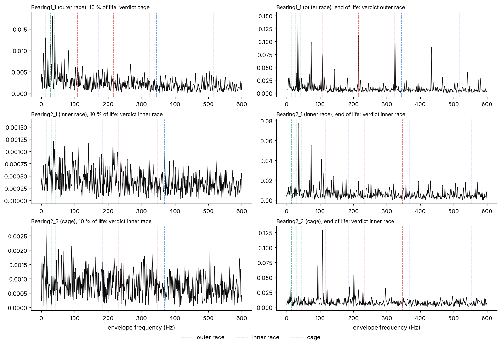

# Results: can envelope analysis tell which component is failing?

Plan, method and evaluation: [`PLAN.md`](PLAN.md), `src/envelope.py` and
`scripts/envelope_eval.py`, committed in `bc6575c` and `1034847` before any raw signal was
analysed. Run once with `python -m scripts.extract_xjtu_raw` and
`python -m scripts.envelope_eval`. Full table: [`diagnoses.csv`](diagnoses.csv), summary:
[`results.json`](results.json).

**Outcome: not useful by its rule.** On the last snapshot the automatic verdict names the
documented component on 8 of the 13 single-fault bearings, exactly what always answering
"outer race" gets. The rule asked for at least 10, with at least 2 of the 3 inner-race
bearings. It got the inner-race part (2 of 3) but not the total.

| Snapshot | Correct (of 13) | Outer race (8) | Inner race (3) | Cage (2) |
|---|---:|---:|---:|---:|
| **Last (primary)** | **8** | 6 | 2 | 0 |
| 90 % of life (secondary) | 10 | 6 | 3 | 1 |
| Start of the final alarm (secondary, 9 bearings) | 5 of 9 | 3 of 5 | 2 of 3 | 0 of 1 |
| Baseline: always "outer race" | 8 | 8 | 0 | 0 |

*Envelope spectra of one bearing per documented component, chosen in advance, at 10 % of life
and at the end of life, with the first three harmonics of each fault frequency (dashed).*

## What happened (descriptive, nothing adopted)

- **A clean outer-race fault is unmistakable.** Bearing1_1 at the end of life shows the
  outer-race frequency (108 Hz) and its harmonics up to the fifth, the textbook picture.
  Bearing3_1 gives the strongest verdict of all (best score 15 times the second). When the
  signature is there, the method finds it.
- **The verdict depends on choices the plan fixed, and 13 bearings cannot absorb that.**
  With a fixed 2 to 10 kHz band instead of the kurtosis-selected one, the last snapshot gives
  10 of 13 on both channels. With the selected band, the snapshot at 90 % of life gives 10
  and the last one 8. On 5 of the 13 last snapshots the kurtosis peak sat at the top of the
  search range (about 10 kHz and above), where impulsive noise can win over the bearing's
  resonance; only 2 of those 5 verdicts are right, against 6 of the other 8.
- **The cage is not found** (0 of 2 on the last snapshot), as on synthetic signals. The
  cage fracture of Bearing1_4 already gave no warning in the RMS trend.
- **Inner-race spectra are dominated by the shaft.** On Bearing2_1 the largest peaks at the
  end of life are the shaft frequency and its harmonics. An inner-race fault rotates with the
  shaft, so its signature spreads into sidebands that a score on the main harmonics does not
  count.
- **There is no "nothing to report" answer.** Healthy snapshots also get a verdict, with
  small margins, because the method always picks a winner. On the late snapshots, the 12
  verdicts with a margin of at least 2 are right on 9; this threshold was read off the
  results, so it is a lead, not a finding.
- **One early signature is real.** Bearing3_5, which degrades within its first 15 minutes,
  already gets a clear outer-race verdict at 10 % of life (margin 4.9).

## What it leaves

Envelope analysis recognises a clear fault signature, but turning it into an automatic
verdict that beats a majority guess needs more than this simple version: a band selection
that resists impulsive noise, sideband-aware scores for the inner race, and an explicit
"unclear" answer below a confidence margin. Each of those would need its own pre-registered
test, and on XJTU-SY it could only be judged on bearings already seen here.
